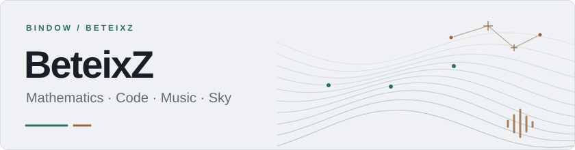
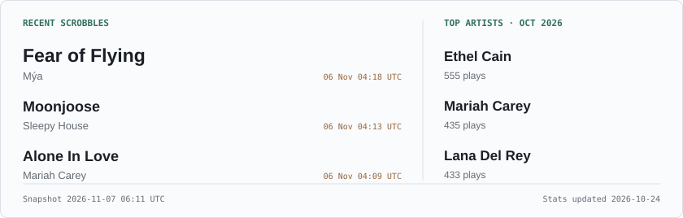

<a href="https://beteixz.github.io/site/">
  <picture>
    <source media="(max-width: 550px) and (prefers-color-scheme: dark)" srcset="assets/banner-mobile-dark.svg">
    <source media="(max-width: 550px)" srcset="assets/banner-mobile-light.svg">
    <source media="(prefers-color-scheme: dark)" srcset="assets/banner-dark.svg">
    
  </picture>
</a>

  <a href="https://beteixz.github.io/site/">Website ↗</a> ·
  <a href="https://beteixz.github.io/site/music/">Music</a> ·
  <a href="https://beteixz.github.io/site/astronomy/">Sky</a> ·
  <a href="https://www.last.fm/user/Beteix">Last.fm</a> ·
  <a href="https://listenbrainz.org/user/Beteix/">ListenBrainz</a>

### Hi there 👋

- 🌱 I’m currently learning PETSc, Numerical PDEs, and some other exciting stuff;
- 🤔 I’m looking for help with how to simplify anything;
- 💬 Ask me about Mathematica.

### On repeat

<a href="https://listenbrainz.org/user/Beteix/">
  <picture>
    <source media="(max-width: 550px) and (prefers-color-scheme: dark)" srcset="assets/music-mobile-dark.svg">
    <source media="(max-width: 550px)" srcset="assets/music-mobile-light.svg">
    <source media="(prefers-color-scheme: dark)" srcset="assets/music-dark.svg">
    
  </picture>
</a>

A listening snapshot, refreshed every three hours · <a href="https://www.last.fm/user/Beteix">More on Last.fm ↗</a>

### Around GitHub

More GitHub activity

---

☝️9/10 myself. (This badge won't show up sometimes.)
